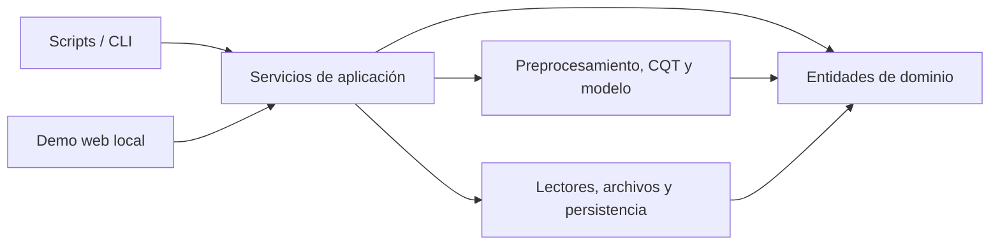

# Arquitectura orientada a objetos

El proyecto se implementa con programación orientada a objetos (POO). Cada clase tiene una responsabilidad concreta, intercambia entidades de dominio tipadas y evita que la interfaz web, los scripts y el entrenamiento dupliquen reglas de negocio.

## 1. Capas y dependencias



- **Dominio:** entidades sin interfaz de usuario: eventos, configuración temporal, resultados de inferencia y reglas de clases.
- **Servicios de aplicación:** coordinan un caso de uso completo, por ejemplo entrenar, evaluar o transcribir un WAV. No conocen HTML ni argumentos de consola.
- **Infraestructura:** lectura de WAV/JAMS, archivos de partición, checkpoints y exportadores CSV/JSON/TXT.
- **Modelo y procesamiento:** clases que encapsulan preprocesamiento, CQT, etiquetas, red neuronal, entrenamiento, evaluación y tablatura.
- **Presentación:** scripts de línea de comandos y `web_app.py`. Ambos llaman al mismo servicio de inferencia.

Las dependencias apuntan hacia el dominio. Ninguna entidad de dominio importa TensorFlow, Flask, una biblioteca web ni argumentos de consola.

## 2. Entidades compartidas

El paquete `src/transcripcion_guitarra` centraliza estas entidades:

| Entidad | Responsabilidad |
|---|---|
| `ConfiguracionAudio` | Parámetros con los que se representa un WAV. |
| `MetadatosFrame` | Tiempos centrales y máscara de frames válidos. |
| `EventoNota` | Cuerda, intervalo temporal y traste de un evento normalizado. |
| `ResultadoInferencia` | Tablatura, eventos, WAV fuente, configuración y checkpoint usados. |

Las constantes del dominio mantienen seis cuerdas, 21 clases por cuerda, clase 0 para silencio y trastes 0 a 19. La entidad `EventoNota` valida índice de cuerda, duración positiva y rango de traste.

## 3. Clases previstas por etapa

| Etapa | Clases principales | Responsabilidad |
|---|---|---|
| E02 | `GuitarSetLoader`, `ValidadorEtiquetas`, `GeneradorParticiones` | Leer pares WAV/JAMS, crear eventos normalizados, registrar incidencias y crear particiones. |
| E03 | `AudioPreprocessor`, `SegmentadorAudio` | Cargar, normalizar y segmentar audio conservando sus tiempos. |
| E04 | `CQTExtractor`, `AlineadorEtiquetas`, `ConstructorLotes` | Crear CQT, alinear eventos a frames y formar lotes con máscara. |
| E05 | `ModelFactory`, `CRNNTranscriptor` | Construir, guardar y cargar las arquitecturas CNN/CRNN. |
| E06 | `Entrenador`, `ExperimentTracker`, `CheckpointRepository` | Entrenar, registrar experimentos y persistir checkpoints. |
| E07 | `Evaluador`, `MetricasPorCuerda`, `ReporteEvaluacion` | Calcular métricas y exportar resultados sin incluir relleno. |
| E08 | `ServicioInferencia`, `SuavizadorPredicciones`, `GeneradorTablatura`, `ExportadorResultados` | Convertir un WAV en estados, eventos y tablatura. |
| Demo local | `ControladorWeb` o adaptador equivalente | Recibir una carga local y mostrar o descargar un `ResultadoInferencia`. |

Las clases de cada etapa se implementan en módulos de `src/transcripcion_guitarra/`. Los scripts en `scripts/` solo crean objetos, reciben argumentos y muestran resultados.

## 4. Reglas de diseño

1. Una clase representa una responsabilidad estable. No mezcla lectura de archivos, cálculo, presentación y persistencia.
2. Los constructores reciben dependencias explícitas. Por ejemplo, `ServicioInferencia` recibe preprocesador, extractor CQT, modelo, suavizador y exportador.
3. Las configuraciones se agrupan en dataclasses inmutables y se guardan junto al experimento o checkpoint.
4. Las reglas de etiquetas, orden de cuerdas, clases y tiempo viven en entidades o servicios de dominio, no se repiten en scripts o HTML.
5. La interfaz web no llama TensorFlow ni procesa archivos directamente. Invoca al mismo `ServicioInferencia` de E08 que usa la CLI.
6. Los errores se representan con excepciones específicas y se traducen a mensajes de consola o web en la capa de presentación.
7. Las pruebas se enfocan en cada clase y en un caso de uso completo. Los dobles de prueba sustituyen lectores, repositorios o modelo cuando sea necesario.

## 5. Flujo de inferencia

```text
ServicioInferencia.transcribir(wav)
  -> AudioPreprocessor.procesar(wav)
  -> CQTExtractor.extraer(audio)
  -> CRNNTranscriptor.predecir(cqt)
  -> SuavizadorPredicciones.aplicar(probabilidades)
  -> GeneradorTablatura.generar(estados, metadatos)
  -> ResultadoInferencia
```

La CLI exporta el resultado y la demo local lo presenta y permite descargarlo. Así se conserva una sola implementación de inferencia y una sola interpretación de tiempos, clases y eventos.
