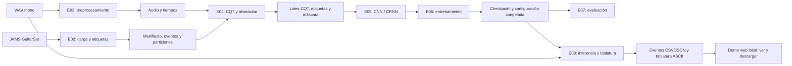

# Contratos de integración y flujo del sistema

**Tarea:** E01-T02 - Definir alcance, flujo e interfaces de módulos  
**Versión del contrato:** 1.1
**Fecha:** 28 de octubre de 2026  
**Estado:** acordado para desarrollo. Los módulos de E02-E08 deben implementarlo y comprobarlo con datos reales antes de declararse terminados.

## 1. Alcance acordado

El sistema procesa un archivo WAV de guitarra y produce estados por cuerda, eventos musicales y tablatura ASCII. Durante entrenamiento usa pares WAV/JAMS de GuitarSet; en inferencia no requiere un archivo JAMS. Una demostración web local permite cargar un solo WAV, consultar la tablatura y descargar los resultados generados.

Dentro del alcance:

- audio WAV mono y sus representaciones temporales/CQT;
- seis cuerdas de guitarra estándar;
- clases de silencio y trastes 0 a 19;
- modelo CNN/CRNN, eventos CSV/JSON y tablatura ASCII.
- interfaz web local para una transcripción por solicitud.

Fuera del alcance de esta versión: reconocimiento de nombres de acordes, MusicXML, procesamiento en tiempo real, otros instrumentos, estimación de trastes fuera de 0-19, despliegue público, cuentas de usuario, persistencia de resultados y procesamiento concurrente de varias cargas. Un evento fuera del rango no se recorta silenciosamente: E02 lo registra como incidencia y aplica la política documentada para excluirlo o conservarlo fuera de la etiqueta de entrenamiento.

## 2. Flujo y responsables



E01 define estas interfaces. E02, E03 y E04 no pueden cambiar una dimensión, código de clase o convención temporal sin actualizar este documento, la configuración afectada y los consumidores. E07 solo usa el conjunto de prueba después de congelar modelo, preprocesamiento y parámetros de suavizado de E08.

## 3. Convenciones comunes

### 3.1 Identificadores y particiones

- `track_id` es el nombre base compartido por `<track_id>_mic.wav` y `<track_id>.jams`.
- Un manifiesto conserva las rutas relativas, el estado de inclusión y la razón de toda exclusión.
- La partición (`train`, `validation` o `test`) se asigna antes de generar ventanas. Un `track_id` pertenece a una sola partición y las tres listas son disjuntas.

### 3.2 Orden de cuerdas

El eje de cuerdas siempre es de grave a aguda. Su índice 0 no es la primera cuerda convencional: es la sexta cuerda (Mi grave).

| Índice de tensor | Cuerda convencional | Nota al aire | MIDI al aire | `data_source` JAMS esperado |
|---:|---:|---|---:|---:|
| 0 | 6 | E2 | 40 | `0` |
| 1 | 5 | A2 | 45 | `1` |
| 2 | 4 | D3 | 50 | `2` |
| 3 | 3 | G3 | 55 | `3` |
| 4 | 2 | B3 | 59 | `4` |
| 5 | 1 | E4 | 64 | `5` |

La conversión preliminar de una altura MIDI a traste es `traste = midi - midi_al_aire`. Antes de volverla una etiqueta discreta, E02 debe registrar desviaciones de semitono, bends y valores fuera de rango. Un valor MIDI continuo no se redondea automáticamente sin una política de etiquetas aprobada y reproducible.

### 3.3 Clases, silencio y relleno

Cada cuerda tiene 21 clases:

| Código de clase | Significado |
|---:|---|
| 0 | Sin nota o cuerda no activa |
| 1 a 20 | Traste 0 a 19, mediante `traste = clase - 1` |

Por tanto, **traste 0 es la clase 1 y no el silencio**. El relleno de una secuencia no es una clase: se representa con `label = -1` y `valid_mask = False`. La pérdida y las métricas deben excluir toda posición con máscara falsa.

### 3.4 Tiempo

- Todos los tiempos se expresan en segundos desde el inicio del WAV original.
- Los eventos usan intervalos semiabiertos `[onset_s, offset_s)` y requieren `duration_s > 0`.
- Las representaciones por frame publican `frame_center_s`, de longitud `T`, y los parámetros que lo reproducen (`sample_rate`, `hop_length` y, cuando aplique, `center` y tamaño de ventana). No se infiere el instante de un frame por su índice.
- Al alinear, un evento está activo si contiene el centro del frame. E04 debe comprobar inicio, zona media y final de una grabación contra esta regla.

## 4. Contratos por módulo

### E02 - `data_loader.py`

**Entrada:** WAV/JAMS emparejados, directorio de datos y configuración de etiquetas.

**Salida mínima:**

- manifiesto con `track_id`, rutas relativas, duración, intérprete/grupo usado para la partición, estado de inclusión y razón de exclusión;
- eventos normalizados con `track_id`, `string_index`, `string_conventional`, `onset_s`, `duration_s`, `offset_s`, `midi_value`, `raw_fret_estimate`, `label_class` (cuando sea aplicable) y motivo de incidencia;
- archivos de partición disjuntos por `track_id`.

**Garantías:** seis fuentes de cuerda reconocidas; metadatos y valores finitos validados; sin pares ambiguos. Las incidencias se reportan, no se corrigen de forma silenciosa.

### E03 - `preprocessing.py`

**Entrada:** ruta WAV incluida y configuración de audio.

**Salida mínima:** `samples` mono en punto flotante, `sample_rate`, duración original, y la transformación aplicada. Si segmenta, cada segmento incluye `start_s`, `end_s` y su relación con el WAV original.

**Garantías:** no introduce NaN/inf; silencio, audio corto y última ventana son válidos; cualquier normalización se ajusta solo con entrenamiento cuando tenga parámetros aprendidos.

### E04 - `cqt_extraction.py`

**Entrada:** salida de E03, eventos normalizados y configuración CQT.

**Salida mínima:**

```text
cqt:        float32 [T, F]          # tiempo, frecuencia; valores finitos
labels:     int16   [T, 6]           # -1 relleno o 0..20
valid_mask: bool    [T]              # False exclusivamente para relleno
frame_center_s: float64 [T]
metadata: sample_rate, hop_length, n_bins, bins_per_octave, fmin, center
```

Al formar lotes, E04 añade los ejes `B` y el canal de entrada: `x [B, T, F, 1]`, `y [B, T, 6]`, `valid_mask [B, T]`. Un consumidor no debe asumir que `T` es igual para todas las grabaciones fuera de un lote ya rellenado.

### E05 - `model_crnn.py`

**Entrada:** `x [B, T, F, 1]`, máscara temporal y configuración del modelo.

**Salida:** probabilidades `float32 [B, T, 6, 21]`; el último eje suma aproximadamente 1 para cada combinación válida de lote, tiempo y cuerda. El modelo conserva `T`.

**Pérdida:** entropía cruzada por cuerda sobre etiquetas 0..20, ponderada por `valid_mask`; nunca interpreta `-1` como una clase.

### E06 - `train.py`

**Entrada:** constructor de E05, lotes/particiones de E04, configuración, semilla y rutas de salida.

**Salida:** checkpoint recuperable, configuración exacta, versión de código, semilla, registro de épocas y métricas de entrenamiento/validación. El conjunto de prueba no interviene en selección de checkpoint ni ajuste de hiperparámetros.

### E07 - `evaluate.py`

**Entrada:** checkpoint y configuración congelados, lote de prueba y `valid_mask`.

**Salida:** métricas por cuerda/clase, matrices de confusión y resultados con la ruta del archivo fuente. Excluye el relleno y reporta soporte de clases activas además de accuracy global.

### E08 - `inference.py` y `tablature_generator.py`

**Entrada:** WAV externo, checkpoint, configuración de E03/E04/E05 y parámetros de suavizado elegidos con validación.

**Salida:**

- estados por frame `class [T, 6]` y sus tiempos;
- eventos CSV/JSON con `string_index`, `string_conventional`, `fret`, `midi_note`, `onset_s` y `offset_s`;
- tablatura ASCII con seis líneas, de cuerda 1 (E4) a cuerda 6 (E2), rotuladas de modo explícito para no confundir el orden de presentación con el eje del tensor.

La inferencia no carga ni exige un JAMS. Silencio, traste 0, audio corto y final incompleto deben conservar su significado definido arriba.

### Demo web local - `web_app.py` (integración de E08)

La aplicación web no implementa una segunda ruta de transcripción: llama a la misma función pública de E08 que usa la interfaz de línea de comandos, con un WAV y una configuración/checkpoint ya seleccionados.

**Entrada:** una solicitud local con un único archivo WAV. Si el archivo no puede leerse, falta el checkpoint o falla la inferencia, la página informa un error claro y no ofrece resultados incompletos como correctos.

**Salida visible:** tablatura ASCII y resumen de eventos de la solicitud actual.

**Descargas:** archivos de tablatura de texto, eventos CSV y eventos JSON producidos por E08. Cada descarga conserva la misma ejecución mostrada en pantalla.

**Límites de operación:** se ejecuta solamente en `localhost`; no requiere cuentas ni JAMS, no guarda historial de usuarios y procesa una carga por solicitud. Los archivos temporales se separan de los resultados finales y no se versionan.

## 5. Casos de aceptación para la integración

Antes de conectar módulos completos, cada autor debe aportar una muestra pequeña con:

1. forma, tipo y rango de cada salida del contrato;
2. un ejemplo por cada extremo del eje temporal (inicio, medio y final);
3. una confirmación explícita del orden de seis cuerdas;
4. una prueba donde silencio (clase 0) y cuerda al aire (clase 1) sean distintos;
5. una comprobación de que no hay NaN/inf, y de que el relleno no contribuye a pérdida ni métricas cuando exista.

Estas son pruebas de interfaz. No sustituyen las validaciones propias de E02-E08 ni constituyen resultados del modelo.

